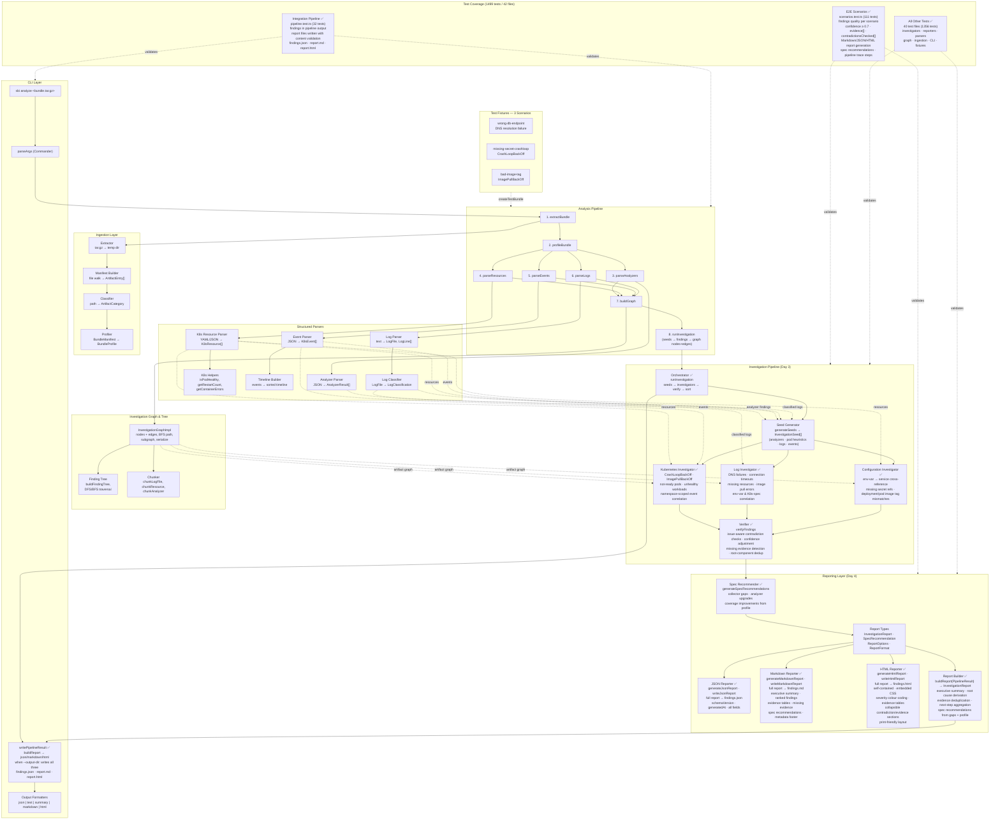

# Support Bundle Investigator (SBI)

> CLI-first, local-first tool that takes a [Troubleshoot](https://troubleshoot.sh/) support bundle `.tar.gz` and produces evidence-backed diagnosis.

**Status: Complete** — full investigation pipeline with **differential diagnosis**, AI-augmented analysis, and 4 seeded failure scenarios verified by **2039 tests across 56 files**.

**Core pipeline:** bundle ingestion → artifact classification → structured parsing (analyzers, K8s resources, events, logs, Helm releases) → investigation graph → seed generation → targeted investigators (Kubernetes, Log, Configuration) → verifier (contradiction checks, confidence adjustment, missing-evidence detection).

**Hypothesis verification layer:** for each observed symptom, 3–5 competing root-cause hypotheses are generated. Supporting, contradicting, and missing decisive evidence is collected per hypothesis. A calibrated scorer ranks them with category-specific decisive bonuses, cross-source rewards, and contradiction/missing-evidence penalties. The top finding includes an explicit runner-up comparison explaining why the winning diagnosis is preferred.

**AI layer (additive):** chunk index, K8s resource relationship graph, lexical search, semantic embeddings (vector store), category-specific LLM playbooks, and graceful degradation to heuristic-only mode. AI findings are annotated in all report formats (`[AI-assisted]` tag in Markdown, 🤖 badge in HTML). The `--no-ai` flag forces heuristic-only mode.

**Spec-gap recommendations:** when confidence is limited by missing bundle data, the system recommends specific collectors, analyzers, or redaction rules to improve future bundles.

---

## Quick Start

```bash
# 1. Install dependencies
npm install

# 2. Build
npm run build

# 3. Run all checks
npm run unit      # unit + integration + e2e via Vitest
npm run lint      # zero-warning ESLint
npm run typecheck # tsc --noEmit

# 4. Analyze a support bundle (heuristic mode — works offline, no API key required)
npx sbi analyze <bundle.tar.gz>
npx sbi analyze bundle.tar.gz --format json --output-dir ./output --verbose --trace

# 5. Analyze with AI-augmented investigation (requires OpenAI API key)
export OPENAI_API_KEY=sk-...
npx sbi analyze bundle.tar.gz
npx sbi analyze bundle.tar.gz --verbose   # shows per-seed retrieval stats
```

---

## AI Mode

SBI supports an **AI-augmented investigation mode** that adds cross-source correlation on top of the heuristic pipeline.  Heuristic mode is the default and works fully offline — AI mode is additive.

### Enabling AI mode

```bash
export OPENAI_API_KEY=sk-...       # required
export SBI_AI_MODEL=gpt-4o         # optional (default: gpt-4o)
export SBI_EMBEDDING_MODEL=text-embedding-3-small  # optional (default)

npx sbi analyze bundle.tar.gz
```

### Disabling AI mode

```bash
# Force heuristic-only mode regardless of API key
npx sbi analyze bundle.tar.gz --no-ai
```

### What AI mode does

The AI investigator runs **after** the heuristic investigators as an additive layer.  For each investigation seed, it:

1. **Graph retrieval** — deterministic K8s resource neighbourhood from the chunk index (precision floor)
2. **Lexical retrieval** — exact identifier matching across all artifact types
3. **Semantic expansion** — embedding-based similarity search for cross-source correlations
4. **LLM structured finding** — `gpt-4o` produces `Finding[]` with mandatory citations to provided chunks.  The LLM cannot invent claims — every finding must cite concrete evidence from the retrieved chunks.  If evidence is insufficient, `missingEvidence` is populated instead of speculating.

AI findings are annotated in all report formats:
- **Markdown**: `[AI-assisted]` tag in the finding heading
- **HTML**: 🤖 badge and `ai-assisted` CSS class on the finding card
- **Executive summary**: notes the count of AI findings and highlights cross-source evidence correlation when present

### Hybrid retrieval architecture

```
Heuristic investigation (always runs)
  → seeds: analyzer errors, pod health, log importance, warning events
  → investigators: Kubernetes | Log | Configuration (category-specific playbooks)
  → verifier: contradiction checks, confidence adjustment, deduplication
        ↓
AI investigation (runs when OPENAI_API_KEY is set and --no-ai is not used)
  → chunk index: log chunks, resource chunks, analyzer chunks, event chunks
  → retrieval (per seed):
      graph traversal     → deterministic resource neighbourhood
      lexical search      → exact identifier matching
      semantic expansion  → embedding cosine similarity (expansion only)
  → LLM call with grounded context → Finding[] with citations
  → merged into verified findings pool
        ↓
Report: findings marked [AI-assisted] for transparency
        root cause prefers cross-source AI findings (evidence from 2+ artifact types)
        executive summary notes AI finding count
```

### Graceful degradation

If AI features fail (invalid API key, network error, LLM error), the pipeline **continues with heuristic results** rather than aborting.  Specific degradation points:

- **No API key** or **`--no-ai`**: heuristic-only mode, no AI calls made
- **Embedding fails**: AI investigation continues with graph + lexical retrieval only (no semantic expansion)
- **LLM call fails for a seed**: that seed is skipped with a warning, remaining seeds proceed
- **LLM response invalid**: findings without citeable evidence are dropped silently

### Demo story

The hybrid mode shows two complementary analysis levels:

```
$ npx sbi analyze bundle.tar.gz --no-ai
→ heuristic mode finds the symptom:
  CRITICAL: CrashLoopBackOff — Pod api-server (8 restarts)
  Recommended action: Check pod logs and startup errors

$ export OPENAI_API_KEY=sk-...
$ npx sbi analyze bundle.tar.gz --verbose
→ [AIInvestigator] Seed: Pod api-server CrashLoopBackOff → 4 graph chunks, 6 lexical chunks, 3 semantic chunks across 3 artifact types
→ AI mode explains the cause through cross-source correlation:
  CRITICAL [AI-assisted]: Database authentication failure causing CrashLoopBackOff
  Evidence:
    cluster-resources/pods/default.json — CrashLoopBackOff (8 restarts)
    logs/api-server/app.log:47 — FATAL: password authentication failed for user "admin"
    cluster-resources/configmaps/default.json — ConfigMap db-config has DB_USER=amdin (typo)
  Root Cause: The pod crashes due to a database authentication failure caused by a ConfigMap typo.
```

---

## Testing the Current State

### Run the full test suite

```bash
npm run unit
```

This runs **2039 tests across 56 test files** covering every layer (including hypothesis verification, golden eval, and Helm parsing):

| Layer | Test Files | Tests | What's Verified |
|-------|-----------|-------|-----------------|
| **Type Guards** | `src/utils/__tests__/type-guards.test.ts` | 51 | Runtime type validation for all domain types |
| **Ingestion** | `src/ingestion/__tests__/extractor.test.ts` | 10 | Safe tar.gz extraction, path traversal rejection, maxSize limits |
| | `src/ingestion/__tests__/profiler.test.ts` | 30 | Artifact classification, namespace extraction, workload discovery, coverage gaps |
| **Parsers** | `src/parsers/__tests__/analyzer-parser.test.ts` | 24 | Troubleshoot analyzer JSON → typed AnalyzerResult[] |
| | `src/parsers/__tests__/k8s-resource-parser.test.ts` | 17 | YAML/JSON → K8sResource[] (pods, deployments, services, secrets) |
| | `src/parsers/__tests__/k8s-helpers.test.ts` | 41 | `isPodHealthy`, `getRestartCount`, `getContainerErrors` health checks |
| | `src/parsers/__tests__/event-parser.test.ts` | 20 | K8s event JSON parsing + normalization |
| | `src/parsers/__tests__/timeline.test.ts` | 30 | Event timeline reconstruction (sorted, filtered, windowed) |
| | `src/parsers/__tests__/log-parser.test.ts` | 39 | Log line level classification, error window extraction, importance scoring |
| **Graph** | `src/graph/__tests__/investigation-graph.test.ts` | 17 | Node/edge CRUD, BFS path finding, subgraph extraction, JSON serialization |
| | `src/graph/__tests__/finding-tree.test.ts` | 21 | Tree construction from edges, DFS/BFS traversal, ancestor/descendant helpers |
| | `src/graph/__tests__/chunker.test.ts` | 16 | Overlapping log chunking, resource/analyzer chunk generation |
| | `src/graph/__tests__/resource-graph.test.ts` | 26 | K8s resource relationship graph: pod→owner edges, label-selector matching, event associations, `getRelatedChunks` traversal |
| **AI Layer** | `src/ai/__tests__/config.test.ts` | 15 | AI config loading, `--no-ai` flag, provider resolution, key detection |
| | `src/ai/__tests__/chunk-indexer.test.ts` | 22 | Chunk index construction, summary derivation per artifact type, stable metadata (id/path/type/lineRange) |
| | `src/ai/__tests__/summarizer.test.ts` | 33 | Per-artifact chunk summary generation (pods, events, logs, analyzers) |
| | `src/ai/__tests__/lexical-search.test.ts` | 42 | Inverted index build, identifier extraction, BM25-style scoring, cross-artifact search |
| | `src/ai/__tests__/llm-client.test.ts` | 21 | LLM client HTTP calls, structured JSON response parsing, retry/error handling |
| | `src/ai/__tests__/prompts.test.ts` | 50 | Category-specific investigation playbooks (crashloop, image-pull, connectivity, configuration, log), prompt structure |
| | `src/ai/__tests__/schemas.test.ts` | 60 | `AIFinding` validation: required fields, confidence clamping, evidence path enforcement, lineRange validation |
| | `src/ai/__tests__/embeddings.test.ts` | 9 | Embedding client batch calls, error handling, graceful degradation on API failure |
| | `src/ai/__tests__/vector-store.test.ts` | 26 | In-memory cosine-similarity vector store: add/query, top-K retrieval, deduplication |
| **Investigators** | `src/investigators/__tests__/seed-generator.test.ts` | 37 | All 4 seed sources, all 3 scenarios, priority ordering, edge cases |
| | `src/investigators/__tests__/kubernetes-investigator.test.ts` | 71 | CrashLoopBackOff, ImagePullBackOff, not-ready pods, unhealthy workloads, namespace-scoped event correlation, graph edges, confidence scoring |
| | `src/investigators/__tests__/log-investigator.test.ts` | 77 | DNS failures, connection timeouts, missing resource errors, image pull failures, confidence tiers, evidence edges |
| | `src/investigators/__tests__/config-investigator.test.ts` | 71 | Missing service env refs, missing secret refs, deployment/pod image mismatch detection, namespace isolation, graph edges |
| | `src/investigators/__tests__/verifier.test.ts` | 57 | Contradiction detection (including issue-aware health checks), confidence adjustment (boosts, penalties), missing evidence detection, and root-component-based finding deduplication/merge |
| | `src/investigators/__tests__/orchestrator.test.ts` | 20 | Full orchestration flow: seed generation, all 3 investigators + AI investigator, result merge, verifier, severity+confidence sort, metadata counters including `aiEnabled`/`aiFindings` |
| | `src/investigators/__tests__/ai-investigator.test.ts` | 31 | AI investigator: graph retrieval, lexical retrieval, semantic expansion, chunk merging, `AIFinding`→`Finding` conversion, graceful LLM failure, verbose retrieval stats |
| **Pipeline** | `src/pipeline/__tests__/analyze-ai.test.ts` | 10 | AI pipeline integration: `aiDeps` construction, AI disabled when `--no-ai`, graceful degradation on AI index build failure |
| **Reporters** | `src/reporters/__tests__/spec-recommender.test.ts` | 31 | Collector/analyzer/redaction recommendations from missing evidence and coverage gaps, deduplication, ordering, combined inputs |
| | `src/reporters/__tests__/json-reporter.test.ts` | 51 | Full JSON report structure, metadata fields, findings/evidence serialization, round-trip parsing, and `findings.json` file output |
| | `src/reporters/__tests__/markdown-reporter.test.ts` | 64 | Section headers, finding count, severity badges, confidence percentages, evidence tables, contradictions, missing evidence, spec recommendations, metadata footer, `[AI-assisted]` tag on AI findings, and `findings.md` file output |
| | `src/reporters/__tests__/html-reporter.test.ts` | 93 | Valid HTML structure, `<!DOCTYPE html>` declaration, embedded CSS, all 5 severity classes, evidence tables, collapsible sections, HTML escaping, 🤖 badge and `ai-assisted` class on AI finding cards, and `findings.html` file output |
| | `src/reporters/__tests__/report-builder.test.ts` | 42 | `buildReport` assembly: executive summary, root-cause derivation, evidence deduplication, next-step/contradiction/missing-evidence aggregation, spec recommendations, empty pipeline handling |
| | `src/reporters/__tests__/report-builder-ai.test.ts` | 21 | `isAIFinding` detection, executive summary AI annotation (count + cross-source note), root-cause preference for cross-source AI findings over single-source |
| **CLI** | `src/cli/__tests__/cli.test.ts` | 19 | Commander argument parsing, format validation, `--no-ai` flag, `--help`/`--version` |
| | `src/cli/__tests__/runner.test.ts` | 4 | CLI runner lifecycle: successful execution, cleanup on report-write failures, early exit on Commander help |
| **Hypothesis** | `src/investigators/__tests__/hypothesis-generator.test.ts` | 71 | Symptom grouping, competing hypothesis generation per symptom type (crashloop/imagepull/not-ready/generic) |
| | `src/investigators/__tests__/hypothesis-evidence-collector.test.ts` | 59 | Per-category evidence collection: supporting/contradicting/missingDecisive, numeric env rejection, service reference validation |
| | `src/investigators/__tests__/hypothesis-ranker.test.ts` | 65 | Scoring formula, specificity bonus, cross-source bonus, contradiction penalty, generic-only cap, spec-gap identification |
| | `src/investigators/__tests__/hypothesis-converter.test.ts` | 44 | Hypothesis→Finding conversion, evidence sanitization, runner-up comparison, severity derivation, merge logic |
| | `src/investigators/__tests__/differential-diagnosis.test.ts` | 70 | Cross-scenario differential diagnosis, contradiction injection, evidence ablation |
| | `src/investigators/__tests__/hypothesis-ranking-integration.test.ts` | 59 | DNS vs connectivity ranking, noise/decoy resilience, counterfactual identifier tests |
| **Helm** | `src/parsers/__tests__/helm-parser.test.ts` | 27 | JSON/YAML Helm release parsing, nested chart objects, edge cases |
| **Golden Eval** | `test/golden/__tests__/*.test.ts` | 104 | Retrieval contracts, grounding validation, adversarial LLM, degradation paths, AI report annotation, golden eval |
| **Fixtures** | `test/fixtures/__tests__/fixtures.test.ts` | 36 | All 4 scenario directories contain correct structure + content |
| **Integration** | `test/integration/__tests__/pipeline.test.ts` | 32 | Full pipeline end-to-end, findings quality, output file writing |
| | `test/integration/__tests__/real-bundle-regression.test.ts` | 4 | Archive-based regression: DNS ranking, numeric evidence rejection, runner-up explanation |
| **E2E Scenarios** | `test/e2e/__tests__/scenarios.test.ts` | 128 | All 4 failure scenarios (wrong-db, missing-secret, bad-image, pvc-pending) through complete pipeline |

### Run specific test groups

```bash
# Unit tests only
npx vitest run src/

# Integration tests
npx vitest run test/integration/

# E2E scenario tests (the 3 seeded failures)
npx vitest run test/e2e/

# A specific parser
npx vitest run src/parsers/__tests__/k8s-helpers.test.ts

# Watch mode for development
npx vitest --watch
```

### Benchmark diagnosis quality + runtime

```bash
# Build first (benchmark uses the compiled CLI)
npm run build

# Heuristic benchmark across the three seeded scenarios
npm run benchmark:hypotheses

# If OPENAI_API_KEY is set, the benchmark automatically adds an AI row
export OPENAI_API_KEY=sk-...
npm run benchmark:hypotheses
```

The benchmark prints a compact table with:

- scenario name
- mode (`heuristic` / `ai`)
- elapsed runtime
- inferred top diagnosis category
- top confidence
- whether top-1 matched the expected root cause
- total findings / hypothesis findings / AI findings

### Try the CLI manually

The project ships with 4 test fixture directories that simulate real Troubleshoot support bundles. You can create a `.tar.gz` from any fixture and run the CLI against it:

```bash
# Build first
npm run build

# Create a test bundle from a fixture
cd test/fixtures/scenarios
tar czf /tmp/wrong-db-endpoint.tar.gz wrong-db-endpoint/
tar czf /tmp/pvc-pending.tar.gz pvc-pending/
tar czf /tmp/missing-secret-crashloop.tar.gz missing-secret-crashloop/
tar czf /tmp/bad-image-tag.tar.gz bad-image-tag/

# Run analysis
npx sbi analyze /tmp/wrong-db-endpoint.tar.gz
npx sbi analyze /tmp/missing-secret-crashloop.tar.gz --format json
npx sbi analyze /tmp/bad-image-tag.tar.gz --format summary --verbose

# Write all reports + trace to a directory
npx sbi analyze /tmp/wrong-db-endpoint.tar.gz --format json --output-dir ./out --trace
cat out/findings.json
cat out/report.md
cat out/trace.json
```

### What to expect from each scenario

| Scenario | Bundle | What You'll See |
|----------|--------|-----------------|
| **wrong-db-endpoint** | `wrong-db-endpoint.tar.gz` | **Investigation findings**: `high`/`critical` finding for DNS resolution failure (`dial tcp: lookup db.internal: no such host`), corroborated by log evidence and analyzer warnings. `recommendedAction` points to checking `DB_HOST` env var. **Reports**: `report.md` includes executive summary with root-cause derivation, evidence table linking log lines to analyzer results, and spec recommendation to add a DNS connectivity collector. `report.html` renders the same in color-coded HTML. |
| **missing-secret-crashloop** | `missing-secret-crashloop.tar.gz` | **Investigation findings**: `critical` finding for `CrashLoopBackOff` (restartCount=8), corroborated by pod status, `BackOff`/`FailedMount` events, and missing `app-credentials` Secret. Config investigator adds a `high` finding for the missing secret reference. **Reports**: Markdown/HTML reports show the evidence chain from Secret absence → FailedMount event → CrashLoopBackOff, with spec recommendations to add a Secret existence collector. |
| **bad-image-tag** | `bad-image-tag.tar.gz` | **Investigation findings**: `critical` finding for `ImagePullBackOff` with `ErrImagePull` events as evidence. Config investigator adds a finding for the `myapp:v999.99.99` image tag mismatch. **Reports**: All three report files include the finding with confidence score, evidence references, and a spec recommendation to add an image registry accessibility collector. |
| **pvc-pending** | `pvc-pending.tar.gz` | **Investigation findings**: findings about `db-pod` stuck in `ContainerCreating` with `FailedMount`/`ProvisioningFailed` events. PVC `data-pvc` references `storageClassName: fast-ssd` which doesn't exist (only `standard` is available). Evidence chain traces from missing StorageClass → PVC Pending → FailedMount → ContainerCreating. **Reports**: spec recommendations suggest adding storage-related collectors and analyzers. |

---

## Report Output

When `--output-dir` is set the CLI writes all three report files in a single pass. Here is what each contains:

```bash
# Generate all reports from a support bundle
npx sbi analyze bundle.tar.gz --output-dir ./reports

# Output:
#   reports/findings.json   — schema-versioned JSON report
#   reports/report.md       — human-readable Markdown report
#   reports/report.html     — self-contained HTML report (no external assets)
```

| Format | Flag | File | Contents |
|--------|------|------|----------|
| **JSON** | `--format json` | `findings.json` | Machine-readable full report: `schemaVersion`, `generatedAt`, `executiveSummary`, `rootCause`, `findings[]` (severity, confidence, evidence[], contradictionsChecked[], recommendedAction), `specRecommendations[]`, `missingEvidence[]` |
| **Markdown** | `--format markdown` | `report.md` | Human-readable: executive summary, ranked findings with severity badges and confidence percentages, per-finding evidence tables, contradictions and missing evidence, spec recommendations section, metadata footer |
| **HTML** | `--format html` | `report.html` | Self-contained HTML with embedded CSS: severity colour-coding (critical=red, high=orange, medium=yellow, low=blue, info=gray), evidence tables, collapsible contradiction/evidence sections, print-friendly layout — no external CDN dependencies |

```bash
# Stream a single format to stdout
npx sbi analyze bundle.tar.gz --format markdown
npx sbi analyze bundle.tar.gz --format html
npx sbi analyze bundle.tar.gz --format json

# Write all reports + trace
npx sbi analyze bundle.tar.gz --output-dir ./reports --trace

# Summary only (bundle profile, no investigation)
npx sbi analyze bundle.tar.gz --format summary
```

---

## Architecture



### Pipeline Data Flow

```
bundle.tar.gz
      │
      ▼
┌─────────────────────────────────────────────────────────┐
│                    CLI  (sbi analyze)                    │
│   parseArgs → analyzeBundlePipeline → writePipelineResult│
└─────────────────────────┬───────────────────────────────┘
                          │
      ┌───────────────────▼────────────────────┐
      │           Analysis Pipeline            │
      │                                        │
      │  1. extractBundle   → BundleManifest   │  Unpack tar.gz safely
      │  2. profileBundle   → BundleProfile    │  Classify every file
      │  3. parseAnalyzers  → AnalyzerResult[] │  Troubleshoot analyzer output
      │  4. parseResources  → K8sResource[]    │  Pods, deployments, services…
      │  5. parseEvents     → K8sEvent[]       │  Warning & Normal events
      │  6. parseLogs       → LogFile[]        │  Line-level classification
      │  7. buildGraph      → InvestigationGraph│  All artifacts as nodes
      └───────────────────┬────────────────────┘
                          │
      ┌───────────────────▼────────────────────┐
      │           PipelineResult               │
      │  profile · analyzerResults · resources │
      │  events · logs · findings              │  ← findings[] added by orchestrator
      │  graph (artifact + evidence + findings)│
      │  trace                                 │
      └───────────────────┬────────────────────┘
                          │
      ┌───────────────────▼────────────────────┐
      │  8. Investigation Orchestrator ✅      │
      │       runInvestigation(context)        │
      │                                        │
      │  1. generateSeeds → InvestigationSeed[]│  Prioritised hypotheses
      │    ├ analyzer error/warn results        │  (priority 60-80)
      │    ├ pod heuristics (crash/pull/ready)  │  (priority 50-90)
      │    ├ high-importance log files          │  (priority 45-55)
      │    └ warning Kubernetes events          │  (priority 30)
      │                                        │
      │  2. investigateKubernetes  ✅          │  CrashLoopBackOff · ImagePullBackOff
      │     investigateLog         ✅          │  not-ready pods · unhealthy workloads
      │     investigateConfig      ✅          │  DNS failures · connection timeouts
      │     (structurally parallel)            │  missing resources · image tag mismatches
      │                                        │
      │  3. merge results                      │  combine findings + edges
      │                                        │
      │  4. verifyFindings         ✅          │  contradiction checks · confidence adjustment
      │                                        │  missing evidence detection · deduplication
      │                                        │
      │  5. sort by severity, confidence       │  critical first, then high/medium/low/info
      │                                        │
      │  6. add finding/evidence nodes + edges │  integrate into InvestigationGraphImpl
      │     to the investigation graph         │
      └───────────────────┬────────────────────┘
                          │
      ┌───────────────────▼────────────────────┐
      │       9. Report Builder ✅             │
      │       buildReport(PipelineResult)      │
      │                                        │
      │  1. generateExecutiveSummary           │  names top finding + severity + action
      │  2. deriveRootCause                    │  highest-ranked finding.reasoningSummary
      │  3. collectEvidenceReferences          │  deduplicated across all findings
      │  4. collectContradictions              │  deduplicated union of contradictionsChecked
      │  5. collectNextSteps                   │  deduplicated recommendedAction per finding
      │  6. collectMissingEvidence             │  deduplicated union of missingEvidence
      │  7. generateSpecRecommendations        │  collector/analyzer/redaction suggestions
      │                                        │
      │     → InvestigationReport              │
      └───────────────────┬────────────────────┘
                          │
      ┌───────────────────▼────────────────────┐
      │  writePipelineResult (CLI output) ✅   │
      │                                        │
      │  --output-dir → all three files:       │
      │    findings.json · report.md · report.html
      │                                        │
      │  no --output-dir → stdout by format:   │
      │    json → JSON report                  │
      │    text / markdown → Markdown report   │
      │    html → HTML report                  │
      │    summary → profile summary           │
      └────────────────────────────────────────┘
```

---

## Project Structure

```
support-bundle-investigator/
├── src/
│   ├── cli/                  # Commander-based CLI
│   │   ├── cli.ts            #   Argument parsing + validation (json|text|summary|markdown|html)
│   │   ├── output.ts         #   Format-specific output; writes findings.json/report.md/report.html
│   │   ├── runner.ts         #   CLI entry point (runCli)
│   │   ├── run.ts            #   Binary entry (bin/sbi)
│   │   └── index.ts          #   Re-exports
│   ├── graph/                # Investigation data structures
│   │   ├── investigation-graph.ts  # Directed graph (nodes, edges, BFS, subgraph)
│   │   ├── finding-tree.ts         # Causal tree (build, DFS/BFS, ancestors)
│   │   ├── chunker.ts              # RAG-ready chunking (logs, resources, analyzers)
│   │   └── index.ts
│   ├── ingestion/            # Bundle unpacking & profiling
│   │   ├── extractor.ts      #   Safe tar.gz extraction with path validation
│   │   ├── manifest.ts       #   Recursive file walk → ArtifactEntry[]
│   │   ├── classifier.ts     #   Path-based artifact category detection
│   │   ├── profiler.ts       #   BundleManifest → BundleProfile
│   │   └── index.ts
│   ├── investigators/        # Investigation pipeline (Day 3)
│   │   ├── types.ts                  #   InvestigationSeed, InvestigatorContext, InvestigatorResult
│   │   ├── seed-generator.ts         #   generateSeeds — prioritised hypothesis generation
│   │   ├── kubernetes-investigator.ts#   investigateKubernetes — CrashLoop/ImagePull/notReady/workloads
│   │   ├── log-investigator.ts       #   investigateLog — log pattern correlation
│   │   ├── config-investigator.ts    #   investigateConfig — service/secret/image checks
│   │   ├── verifier.ts               #   verifyFindings — contradictions, confidence, dedup
│   │   ├── orchestrator.ts           #   runInvestigation — full pipeline orchestration
│   │   ├── __tests__/                #   Co-located investigator test suites
│   │   └── index.ts                  #   Re-exports
│   ├── parsers/              # Structured data parsers
│   │   ├── analyzer-parser.ts    # Troubleshoot analyzer JSON
│   │   ├── k8s-resource-parser.ts # YAML/JSON K8s resources
│   │   ├── k8s-helpers.ts        # Pod health, restart count, container errors
│   │   ├── event-parser.ts       # K8s event parsing
│   │   ├── timeline.ts           # Event timeline construction
│   │   ├── log-parser.ts         # Log file parsing + line classification
│   │   ├── log-classifier.ts     # Log category + importance ranking
│   │   └── index.ts
│   ├── pipeline/             # Orchestration
│   │   ├── analyze.ts        #   analyzeBundlePipeline (8-step pipeline, includes investigation)
│   │   ├── trace.ts          #   Investigation trace (step timing + counts)
│   │   └── index.ts
│   ├── reporters/            # Reporting layer (Day 4)
│   │   ├── types.ts          #   InvestigationReport, SpecRecommendation, ReportOptions
│   │   ├── spec-recommender.ts #  generateSpecRecommendations — collector/analyzer/redaction suggestions
│   │   ├── json-reporter.ts  #   generateJsonReport / writeJsonReport → findings.json
│   │   ├── markdown-reporter.ts # generateMarkdownReport / writeMarkdownReport → findings.md
│   │   ├── html-reporter.ts  #   generateHtmlReport / writeHtmlReport → findings.html (self-contained, embedded CSS)
│   │   ├── report-builder.ts #   buildReport(PipelineResult) → InvestigationReport (executive summary, root cause, dedup)
│   │   ├── __tests__/        #   Co-located reporter test suites
│   │   └── index.ts          #   Re-exports
│   ├── types/                # All TypeScript domain types
│   │   ├── bundle.ts         #   ArtifactEntry, BundleManifest, BundleProfile
│   │   ├── analyzer.ts       #   AnalyzerResult, AnalyzerSeverity
│   │   ├── kubernetes.ts     #   K8sResource, PodStatus, K8sEvent
│   │   ├── finding.ts        #   Finding, Evidence, FindingSeverity
│   │   ├── graph.ts          #   GraphNode, GraphEdge, FindingTreeNode
│   │   ├── rag.ts            #   Chunk, RetrieverInterface
│   │   └── index.ts
│   ├── utils/
│   │   └── type-guards.ts    #   Runtime type guards for all domain types
│   └── index.ts              # Public API + ESM/CJS entry
├── test/
│   ├── fixtures/
│   │   ├── scenarios/        # 3 seeded failure scenarios
│   │   │   ├── wrong-db-endpoint/
│   │   │   ├── missing-secret-crashloop/
│   │   │   └── bad-image-tag/
│   │   └── __tests__/        # Fixture integrity tests
│   ├── helpers/
│   │   └── create-test-bundle.ts  # Pack scenario dirs into .tar.gz
│   ├── integration/          # Pipeline integration tests
│   ├── e2e/                  # Full scenario E2E tests
│   └── placeholder.test.ts
├── docs/
│   ├── architecture.mmd      # Mermaid source for architecture diagram
│   ├── architecture.svg      # Rendered architecture diagram
│   └── support_bundle_investigator_prd_v2.md
├── dist/                     # Build output (CJS + ESM + d.ts)
├── package.json
├── tsconfig.json
├── tsup.config.ts
├── vitest.config.ts
└── .eslintrc.json
```

---

## Domain Types

### Core Types

| Type | File | Purpose |
|------|------|---------|
| `ArtifactEntry` | `types/bundle.ts` | Single file in the extracted bundle (path, size, category) |
| `BundleManifest` | `types/bundle.ts` | Full file listing after extraction |
| `BundleProfile` | `types/bundle.ts` | Classified manifest with counts, namespaces, workloads, gaps |
| `AnalyzerResult` | `types/analyzer.ts` | One Troubleshoot analyzer finding (severity, pass/fail/warn) |
| `K8sResource` | `types/kubernetes.ts` | Any Kubernetes object (apiVersion, kind, metadata, spec, status) |
| `PodStatus` | `types/kubernetes.ts` | Pod phase, conditions, container statuses, restart count |
| `K8sEvent` | `types/kubernetes.ts` | Kubernetes event (type, reason, message, involved object) |
| `Finding` | `types/finding.ts` | Investigation finding with evidence chain, confidence, recommendations |
| `Evidence` | `types/finding.ts` | Pointer to a specific artifact with explanatory note |

### Graph Types

| Type | File | Purpose |
|------|------|---------|
| `GraphNode<T>` | `types/graph.ts` | Typed node: finding, evidence, artifact, hypothesis, or symptom |
| `GraphEdge` | `types/graph.ts` | Directed edge: supports, contradicts, causes, correlates, derived-from |
| `FindingTreeNode` | `types/graph.ts` | Tree node linking a Finding to its causal children |
| `InvestigationGraphImpl` | `graph/investigation-graph.ts` | Mutable directed graph with BFS, subgraph, and serialization |

### Investigator Types (Day 3)

| Type | File | Purpose |
|------|------|---------|
| `InvestigationSeed` | `investigators/types.ts` | A prioritised hypothesis (id, hypothesis, source, category, priority) |
| `InvestigatorContext` | `investigators/types.ts` | All parsed bundle data available to investigators |
| `InvestigatorResult` | `investigators/types.ts` | Findings + graph edges produced by a targeted investigator |
| `SeedCategory` | `investigators/types.ts` | `kubernetes` \| `log` \| `configuration` \| `connectivity` |
| `verifyFindings` | `investigators/verifier.ts` | Cross-investigator verification: contradiction checks, confidence adjustment, missing-evidence detection, deduplication |
| `InvestigationResult` | `investigators/orchestrator.ts` | Full orchestration result: `findings[]`, `edges[]`, `seeds[]`, and `metadata` counters |
| `runInvestigation` | `investigators/orchestrator.ts` | Full pipeline: seeds → investigators → merge → verify → sort by severity+confidence |

### Reporter Types (Day 4)

| Type | File | Purpose |
|------|------|---------|
| `InvestigationReport` | `reporters/types.ts` | Top-level report: executive summary, ranked findings, root cause, evidence references, contradictions, next steps, missing evidence, spec recommendations |
| `SpecRecommendation` | `reporters/types.ts` | A single suggested spec improvement: `type` (`collector` \| `analyzer` \| `redaction`), `description`, `rationale` |
| `ReportOptions` | `reporters/types.ts` | Output configuration: `format`, `outputDir`, `includeTrace` |
| `generateSpecRecommendations` | `reporters/spec-recommender.ts` | Generates `SpecRecommendation[]` from findings (missing evidence → collectors, heuristic findings → analyzers) and profile coverage gaps |
| `generateJsonReport` | `reporters/json-reporter.ts` | Serializes the full `InvestigationReport` to formatted JSON with metadata (`schemaVersion`, `generatedAt`) |
| `writeJsonReport` | `reporters/json-reporter.ts` | Writes `findings.json` to disk and returns the written absolute path |
| `generateMarkdownReport` | `reporters/markdown-reporter.ts` | Renders the full `InvestigationReport` as a Markdown document with executive summary, ranked findings (severity badge, confidence, evidence table, contradictions, recommended action), missing evidence, spec recommendations, and metadata footer |
| `writeMarkdownReport` | `reporters/markdown-reporter.ts` | Writes `findings.md` to disk and returns the written absolute path |
| `generateHtmlReport` | `reporters/html-reporter.ts` | Renders the full `InvestigationReport` as a self-contained HTML document with embedded CSS, severity colour-coding (critical=red, high=orange, medium=yellow, low=blue, info=gray), evidence tables, collapsible contradiction/evidence sections, and a print-friendly layout |
| `writeHtmlReport` | `reporters/html-reporter.ts` | Writes `findings.html` to disk and returns the written absolute path |
| `buildReport` | `reporters/report-builder.ts` | Assembles a complete `InvestigationReport` from a `PipelineResult`: generates executive summary, derives root cause from highest-ranked finding, deduplicates evidence references, collects next steps and contradictions, and generates spec recommendations |

### AI Retrieval Types

| Type | File | Purpose |
|------|------|---------|
| `Chunk` | `types/rag.ts` | Text chunk with line range + metadata, ready for embedding |
| `RetrieverInterface` | `types/rag.ts` | Interface for vector-store retrieval (to be implemented) |

---

## CLI Reference

```
Usage: sbi [options] [command]

Support Bundle Investigator — evidence-backed diagnosis from support bundles

Options:
  -V, --version                    output the version number
  -h, --help                       display help for command

Commands:
  analyze [options] <bundle-path>  Analyze a support bundle .tar.gz archive
  help [command]                   display help for command
```

### `sbi analyze`

```
Usage: sbi analyze [options] <bundle-path>

Arguments:
  bundle-path         Path to the support bundle .tar.gz file

Options:
  --output-dir <dir>  Directory to write output artifacts
  --format <format>   Output format: json | text | summary | markdown | html (default: "text")
  --verbose           Enable verbose pipeline logging
  --trace             Write a trace.json to the output directory
  -h, --help          display help for command
```

| Flag | Description | Default |
|------|-------------|---------|
| `--format json` | Full structured JSON report to stdout (or `findings.json` when `--output-dir` set) | — |
| `--format text` | Human-readable Markdown report to stdout | `text` |
| `--format markdown` | Markdown report to stdout | — |
| `--format html` | Self-contained HTML report to stdout | — |
| `--format summary` | Bundle profile summary only | — |
| `--output-dir <dir>` | Write all three reports (`findings.json`, `report.md`, `report.html`) plus optional `trace.json` | — |
| `--verbose` | Print `[pipeline] ...` step logs to stdout; shows per-seed AI retrieval stats when AI is active | `false` |
| `--trace` | Write `trace.json` (step timing + artifact counts) to `--output-dir` | `false` |
| `--no-ai` | Disable AI features and run in heuristic-only mode (offline-safe) | `false` |

When `--output-dir` is set, the CLI always writes all three report files regardless of `--format`:
- `findings.json` — full structured report (schema-versioned JSON)
- `report.md` — human-readable Markdown with executive summary, ranked findings, evidence tables, spec recommendations
- `report.html` — self-contained HTML with embedded CSS, severity colour-coding, and collapsible sections

---

## Design Decisions

### Why TypeScript?
Strong static typing prevents entire classes of runtime bugs when dealing with heterogeneous YAML/JSON artifacts. Type guards normalize Kubernetes API objects safely.

### Why local-first?
Support bundles contain sensitive cluster data. Running analysis locally (no network required) keeps data on the operator's machine and enables offline investigation.

### Why the Investigation Graph?
`InvestigationGraphImpl` stores every parsed artifact (analyzer findings, K8s resources, events, log files) as a typed node. Edges model causal relationships (`causes`), corroborating evidence (`supports`), and contradictions (`contradicts`). This enables:
- Traversal-based root-cause isolation (Day 3)
- Evidence chain visualization (Day 4)
- Vector-embedding and RAG retrieval (Day 5)

### Why Finding Trees?
`buildFindingTree` organizes `Finding` objects into a causal forest where a root node represents a root cause and children represent downstream symptoms. DFS/BFS traversal methods allow reporters to walk the tree in any order.

### Why separate investigators?
Each investigator (`KubernetesInvestigator`, `LogInvestigator`, `ConfigInvestigator`) focuses on a single evidence domain. This keeps each module small and independently testable, and makes it easy to add new investigators (e.g., a `NetworkInvestigator`) without changing existing ones. It also maps cleanly onto future TUI drill-down panels — one tab per investigator domain — without requiring any changes to investigation logic.

### Why a Verifier pass?
Contradiction checking and confidence adjustment are core to trustworthy output per PRD principles 10.2 (confidence scores) and 10.4 (contradiction detection). A dedicated `verifyFindings` pass runs after all investigators have produced their findings. This separation means investigators can focus on pattern detection without worrying about cross-investigator consistency — the Verifier resolves that as a second pass. It also deduplicates root-component findings (e.g., two investigators flagging the same crashing pod) and surfaces missing-evidence gaps that the spec recommender then converts into actionable collector suggestions.

### Why data-first reporters?
`InvestigationReport` is a pure data structure produced by `buildReport(PipelineResult)`. Renderers (JSON, Markdown, HTML) consume it without any investigation logic. This keeps presentation completely separate from analysis, meaning a future TUI renderer — or any other output format — can be added by implementing a single rendering function without touching investigators or the report builder.

### Why TDD throughout?
Every module was built test-first. The 1499 tests serve as executable specification and regression safety net. The 3 seeded scenarios act as acceptance tests verifying the tool produces meaningful results on realistic failure modes. E2E tests verify the full investigation pipeline end-to-end: findings quality (severity, confidence >= 0.7, populated evidence and contradictions), all three report formats, spec recommendation generation, AI-assisted report annotation, and pipeline trace completeness.

---

## AI Retrieval Foundation

Every artifact in the pipeline is chunkable via the `Chunk` interface:

```typescript
import { chunkLogFile, chunkResource, chunkAnalyzer } from './src/graph/index.js';

// Chunk a log file into overlapping windows (20 lines, 5-line overlap)
const logChunks = chunkLogFile(logFile, 20, 5);

// Chunk a K8s resource (single chunk = full resource JSON)
const podChunk = chunkResource(pod, 'path/to/pod.yaml');

// Chunk an analyzer result
const analyzerChunk = chunkAnalyzer(analyzerResult);
```

Each `Chunk` carries `id`, `artifactId`, `startLine`/`endLine`, `content`, and typed `metadata` — the stable citation and retrieval substrate used by the AI investigation pipeline.

The `RetrieverInterface` in `types/rag.ts` documents the vector-store retrieval contract that now sits behind semantic expansion.

---

## Seeded Failure Scenarios

Three realistic failure scenarios live in `test/fixtures/scenarios/`:

| Scenario | Root Cause | Key Signals |
|----------|------------|-------------|
| **wrong-db-endpoint** | `DB_HOST` env var points to non-existent DNS name | Log: `dial tcp: lookup db.internal: no such host` |
| **missing-secret-crashloop** | `app-credentials` Secret missing; pod crashes on startup | Pod: `CrashLoopBackOff`, restartCount=8, Event: `FailedMount` |
| **bad-image-tag** | Image tag `myapp:v999.99.99` does not exist in registry | Pod: `ImagePullBackOff`, Event: `ErrImagePull` |

Each scenario contains:
- `version.yaml` — bundle metadata
- `analyzers/output.json` — pre-computed Troubleshoot analyzer results
- `cluster-resources/pods/` — pod manifests with realistic status blocks
- `cluster-resources/events/` — Kubernetes events in JSON
- `cluster-resources/deployments/` or `services/` — related resources
- `logs/` — application log files with error patterns

---

## Roadmap

| Phase | Status | Description |
|-------|--------|-------------|
| **Day 1** | ✅ Complete | Bundle ingestion, extraction, profiling, artifact classification |
| **Day 2** | ✅ Complete | Structured parsing (analyzers, K8s resources, events, logs), investigation graph, finding tree, CLI |
| **Day 3** | ✅ Complete | Investigation pipeline: seed generation, Kubernetes investigator, log investigator, configuration investigator, verifier, orchestrator — all complete. `PipelineResult.findings[]` populated end-to-end. |
| **Day 4** | ✅ Complete | Reporting layer complete: `InvestigationReport` / `SpecRecommendation` types; `generateSpecRecommendations`; JSON/Markdown/HTML reporters; `buildReport(PipelineResult) → InvestigationReport` (executive summary, root cause, deduplication); CLI extended to `json \| text \| summary \| markdown \| html`; `--output-dir` writes all three files (`findings.json`, `report.md`, `report.html`). |
| **Day 4 (E2E)** | ✅ Complete | End-to-end and integration tests for the full investigation+reporting pipeline: per-scenario finding quality checks (severity, confidence ≥ 0.7, evidence[] / contradictionsChecked[] / recommendedAction population), Markdown/JSON/HTML report generation and file content validation, spec recommendation generation, pipeline trace investigation step verification. 1499 tests across 42 test files. |
| **Day 5** | ✅ Complete | AI-augmented investigation: chunk indexing, deterministic graph traversal, lexical retrieval, semantic expansion, grounded LLM findings, graceful degradation, and report annotations |
