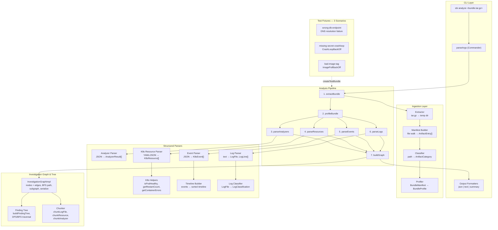

# Support Bundle Investigator (SBI)

> CLI-first, local-first tool that takes a [Troubleshoot](https://troubleshoot.sh/) support bundle `.tar.gz` and produces evidence-backed diagnosis.

**Status: Day 1 + Day 2 complete** — bundle ingestion, artifact classification, structured parsing of analyzers/K8s resources/events/logs, investigation graph, and finding tree are all wired through a CLI and verified against 3 seeded failure scenarios.

---

## Quick Start

```bash
# 1. Install dependencies
npm install

# 2. Build
npm run build

# 3. Run all checks (428 tests)
npm test          # unit + integration + e2e
npm run lint      # zero-warning ESLint
npm run typecheck # tsc --noEmit

# 4. Analyze a support bundle
npx sbi analyze <bundle.tar.gz>
npx sbi analyze bundle.tar.gz --format json --output-dir ./output --verbose --trace
```

---

## Testing the Current State

### Run the full test suite

```bash
npm test
```

This runs **428 tests across 17 test files** covering every layer:

| Layer | Test Files | Tests | What's Verified |
|-------|-----------|-------|-----------------|
| **Type Guards** | `src/utils/__tests__/type-guards.test.ts` | 51 | Runtime type validation for all domain types |
| **Ingestion** | `src/ingestion/__tests__/extractor.test.ts` | 10 | Safe tar.gz extraction, path traversal rejection, maxSize limits |
| | `src/ingestion/__tests__/profiler.test.ts` | 21 | Artifact classification, namespace extraction, workload discovery, coverage gaps |
| **Parsers** | `src/parsers/__tests__/analyzer-parser.test.ts` | 22 | Troubleshoot analyzer JSON → typed AnalyzerResult[] |
| | `src/parsers/__tests__/k8s-resource-parser.test.ts` | 17 | YAML/JSON → K8sResource[] (pods, deployments, services, secrets) |
| | `src/parsers/__tests__/k8s-helpers.test.ts` | 41 | `isPodHealthy`, `getRestartCount`, `getContainerErrors` health checks |
| | `src/parsers/__tests__/event-parser.test.ts` | 20 | K8s event JSON parsing + normalization |
| | `src/parsers/__tests__/timeline.test.ts` | 30 | Event timeline reconstruction (sorted, filtered, windowed) |
| | `src/parsers/__tests__/log-parser.test.ts` | 39 | Log line level classification, error window extraction, importance scoring |
| **Graph** | `src/graph/__tests__/investigation-graph.test.ts` | 17 | Node/edge CRUD, BFS path finding, subgraph extraction, JSON serialization |
| | `src/graph/__tests__/finding-tree.test.ts` | 21 | Tree construction from edges, DFS/BFS traversal, ancestor/descendant helpers |
| | `src/graph/__tests__/chunker.test.ts` | 16 | Overlapping log chunking, resource/analyzer chunk generation |
| **CLI** | `src/cli/__tests__/cli.test.ts` | 14 | Commander argument parsing, format validation, --help/--version |
| **Fixtures** | `test/fixtures/__tests__/fixtures.test.ts` | 36 | All 3 scenario directories contain correct structure + content |
| **Integration** | `test/integration/__tests__/pipeline.test.ts` | 19 | Full pipeline end-to-end, output file writing, trace generation |
| **E2E Scenarios** | `test/e2e/__tests__/scenarios.test.ts` | 53 | All 3 failure scenarios through complete pipeline with diagnostic assertions |

### Run specific test groups

```bash
# Unit tests only
npx vitest run src/

# Integration tests
npx vitest run test/integration/

# E2E scenario tests (the 3 seeded failures)
npx vitest run test/e2e/

# A specific parser
npx vitest run src/parsers/__tests__/k8s-helpers.test.ts

# Watch mode for development
npx vitest --watch
```

### Try the CLI manually

The project ships with 3 test fixture directories that simulate real Troubleshoot support bundles. You can create a `.tar.gz` from any fixture and run the CLI against it:

```bash
# Build first
npm run build

# Create a test bundle from a fixture
cd test/fixtures/scenarios
tar czf /tmp/wrong-db-endpoint.tar.gz wrong-db-endpoint/
tar czf /tmp/missing-secret-crashloop.tar.gz missing-secret-crashloop/
tar czf /tmp/bad-image-tag.tar.gz bad-image-tag/

# Run analysis
npx sbi analyze /tmp/wrong-db-endpoint.tar.gz
npx sbi analyze /tmp/missing-secret-crashloop.tar.gz --format json
npx sbi analyze /tmp/bad-image-tag.tar.gz --format summary --verbose

# Write JSON output + trace to a directory
npx sbi analyze /tmp/wrong-db-endpoint.tar.gz --format json --output-dir ./out --trace
cat out/result.json
cat out/trace.json
```

### What to expect from each scenario

| Scenario | Bundle | What You'll See |
|----------|--------|-----------------|
| **wrong-db-endpoint** | `wrong-db-endpoint.tar.gz` | Analyzer error about DB connectivity. Logs contain `dial tcp: lookup db.internal: no such host`. Pod running but app failing. |
| **missing-secret-crashloop** | `missing-secret-crashloop.tar.gz` | Analyzer error about pod restarts. Pod in `CrashLoopBackOff` with restartCount=8. Events show `BackOff` + `FailedMount`. Secret `app-credentials` referenced but absent. |
| **bad-image-tag** | `bad-image-tag.tar.gz` | Analyzer error about image pull failure. Pod in `ImagePullBackOff`. Events show `ErrImagePull` for `myapp:v999.99.99`. |

---

## Architecture



### Pipeline Data Flow

```
bundle.tar.gz
      │
      ▼
┌─────────────────────────────────────────────────────────┐
│                    CLI  (sbi analyze)                    │
│   parseArgs → analyzeBundlePipeline → writePipelineResult│
└─────────────────────────┬───────────────────────────────┘
                          │
      ┌───────────────────▼────────────────────┐
      │           Analysis Pipeline            │
      │                                        │
      │  1. extractBundle   → BundleManifest   │  Unpack tar.gz safely
      │  2. profileBundle   → BundleProfile    │  Classify every file
      │  3. parseAnalyzers  → AnalyzerResult[] │  Troubleshoot analyzer output
      │  4. parseResources  → K8sResource[]    │  Pods, deployments, services…
      │  5. parseEvents     → K8sEvent[]       │  Warning & Normal events
      │  6. parseLogs       → LogFile[]        │  Line-level classification
      │  7. buildGraph      → InvestigationGraph│  All artifacts as nodes
      └───────────────────┬────────────────────┘
                          │
      ┌───────────────────▼────────────────────┐
      │           PipelineResult               │
      │  profile · analyzerResults · resources │
      │  events · logs · graph · trace         │
      └────────────────────────────────────────┘
```

---

## Project Structure

```
support-bundle-investigator/
├── src/
│   ├── cli/                  # Commander-based CLI
│   │   ├── cli.ts            #   Argument parsing + validation
│   │   ├── output.ts         #   Format-specific output (json/text/summary)
│   │   ├── runner.ts         #   CLI entry point (runCli)
│   │   ├── run.ts            #   Binary entry (bin/sbi)
│   │   └── index.ts          #   Re-exports
│   ├── graph/                # Investigation data structures
│   │   ├── investigation-graph.ts  # Directed graph (nodes, edges, BFS, subgraph)
│   │   ├── finding-tree.ts         # Causal tree (build, DFS/BFS, ancestors)
│   │   ├── chunker.ts              # RAG-ready chunking (logs, resources, analyzers)
│   │   └── index.ts
│   ├── ingestion/            # Bundle unpacking & profiling
│   │   ├── extractor.ts      #   Safe tar.gz extraction with path validation
│   │   ├── manifest.ts       #   Recursive file walk → ArtifactEntry[]
│   │   ├── classifier.ts     #   Path-based artifact category detection
│   │   ├── profiler.ts       #   BundleManifest → BundleProfile
│   │   └── index.ts
│   ├── parsers/              # Structured data parsers
│   │   ├── analyzer-parser.ts    # Troubleshoot analyzer JSON
│   │   ├── k8s-resource-parser.ts # YAML/JSON K8s resources
│   │   ├── k8s-helpers.ts        # Pod health, restart count, container errors
│   │   ├── event-parser.ts       # K8s event parsing
│   │   ├── timeline.ts           # Event timeline construction
│   │   ├── log-parser.ts         # Log file parsing + line classification
│   │   ├── log-classifier.ts     # Log category + importance ranking
│   │   └── index.ts
│   ├── pipeline/             # Orchestration
│   │   ├── analyze.ts        #   analyzeBundlePipeline (7-step pipeline)
│   │   ├── trace.ts          #   Investigation trace (step timing + counts)
│   │   └── index.ts
│   ├── types/                # All TypeScript domain types
│   │   ├── bundle.ts         #   ArtifactEntry, BundleManifest, BundleProfile
│   │   ├── analyzer.ts       #   AnalyzerResult, AnalyzerSeverity
│   │   ├── kubernetes.ts     #   K8sResource, PodStatus, K8sEvent
│   │   ├── finding.ts        #   Finding, Evidence, FindingSeverity
│   │   ├── graph.ts          #   GraphNode, GraphEdge, FindingTreeNode
│   │   ├── rag.ts            #   Chunk, RetrieverInterface
│   │   └── index.ts
│   ├── utils/
│   │   └── type-guards.ts    #   Runtime type guards for all domain types
│   └── index.ts              # Public API + ESM/CJS entry
├── test/
│   ├── fixtures/
│   │   ├── scenarios/        # 3 seeded failure scenarios
│   │   │   ├── wrong-db-endpoint/
│   │   │   ├── missing-secret-crashloop/
│   │   │   └── bad-image-tag/
│   │   └── __tests__/        # Fixture integrity tests
│   ├── helpers/
│   │   └── create-test-bundle.ts  # Pack scenario dirs into .tar.gz
│   ├── integration/          # Pipeline integration tests
│   ├── e2e/                  # Full scenario E2E tests
│   └── placeholder.test.ts
├── docs/
│   ├── architecture.mmd      # Mermaid source for architecture diagram
│   ├── architecture.svg      # Rendered architecture diagram
│   └── support_bundle_investigator_prd_v2.md
├── dist/                     # Build output (CJS + ESM + d.ts)
├── package.json
├── tsconfig.json
├── tsup.config.ts
├── vitest.config.ts
└── .eslintrc.json
```

---

## Domain Types

### Core Types

| Type | File | Purpose |
|------|------|---------|
| `ArtifactEntry` | `types/bundle.ts` | Single file in the extracted bundle (path, size, category) |
| `BundleManifest` | `types/bundle.ts` | Full file listing after extraction |
| `BundleProfile` | `types/bundle.ts` | Classified manifest with counts, namespaces, workloads, gaps |
| `AnalyzerResult` | `types/analyzer.ts` | One Troubleshoot analyzer finding (severity, pass/fail/warn) |
| `K8sResource` | `types/kubernetes.ts` | Any Kubernetes object (apiVersion, kind, metadata, spec, status) |
| `PodStatus` | `types/kubernetes.ts` | Pod phase, conditions, container statuses, restart count |
| `K8sEvent` | `types/kubernetes.ts` | Kubernetes event (type, reason, message, involved object) |
| `Finding` | `types/finding.ts` | Investigation finding with evidence chain, confidence, recommendations |
| `Evidence` | `types/finding.ts` | Pointer to a specific artifact with explanatory note |

### Graph Types

| Type | File | Purpose |
|------|------|---------|
| `GraphNode<T>` | `types/graph.ts` | Typed node: finding, evidence, artifact, hypothesis, or symptom |
| `GraphEdge` | `types/graph.ts` | Directed edge: supports, contradicts, causes, correlates, derived-from |
| `FindingTreeNode` | `types/graph.ts` | Tree node linking a Finding to its causal children |
| `InvestigationGraphImpl` | `graph/investigation-graph.ts` | Mutable directed graph with BFS, subgraph, and serialization |

### RAG Types (Ready for Day 5)

| Type | File | Purpose |
|------|------|---------|
| `Chunk` | `types/rag.ts` | Text chunk with line range + metadata, ready for embedding |
| `RetrieverInterface` | `types/rag.ts` | Interface for vector-store retrieval (to be implemented) |

---

## CLI Reference

```
Usage: sbi [options] [command]

Support Bundle Investigator — evidence-backed diagnosis from support bundles

Options:
  -V, --version                    output the version number
  -h, --help                       display help for command

Commands:
  analyze [options] <bundle-path>  Analyze a support bundle .tar.gz archive
  help [command]                   display help for command
```

### `sbi analyze`

```
Usage: sbi analyze [options] <bundle-path>

Arguments:
  bundle-path         Path to the support bundle .tar.gz file

Options:
  --output-dir <dir>  Directory to write output artifacts
  --format <format>   Output format: json | text | summary (default: "text")
  --verbose           Enable verbose pipeline logging
  --trace             Write a trace.json to the output directory
  -h, --help          display help for command
```

| Flag | Description | Default |
|------|-------------|---------|
| `--format <fmt>` | `json` (structured), `text` (human-readable), `summary` (profile only) | `text` |
| `--output-dir <dir>` | Write `result.json` and optionally `trace.json` to this dir | temp dir |
| `--verbose` | Print `[pipeline] ...` step logs to stderr | `false` |
| `--trace` | Write `trace.json` (step timing + artifact counts) | `false` |

---

## Design Decisions

### Why TypeScript?
Strong static typing prevents entire classes of runtime bugs when dealing with heterogeneous YAML/JSON artifacts. Type guards normalize Kubernetes API objects safely.

### Why local-first?
Support bundles contain sensitive cluster data. Running analysis locally (no network required) keeps data on the operator's machine and enables offline investigation.

### Why the Investigation Graph?
`InvestigationGraphImpl` stores every parsed artifact (analyzer findings, K8s resources, events, log files) as a typed node. Edges model causal relationships (`causes`), corroborating evidence (`supports`), and contradictions (`contradicts`). This enables:
- Traversal-based root-cause isolation (Day 3)
- Evidence chain visualization (Day 4)
- Vector-embedding and RAG retrieval (Day 5)

### Why Finding Trees?
`buildFindingTree` organizes `Finding` objects into a causal forest where a root node represents a root cause and children represent downstream symptoms. DFS/BFS traversal methods allow reporters to walk the tree in any order.

### Why TDD throughout?
Every module was built test-first. The 428 tests serve as executable specification and regression safety net. The 3 seeded scenarios act as acceptance tests verifying the tool produces meaningful results on realistic failure modes.

---

## RAG-Readiness

Every artifact in the pipeline is chunkable via the `Chunk` interface:

```typescript
import { chunkLogFile, chunkResource, chunkAnalyzer } from './src/graph/index.js';

// Chunk a log file into overlapping windows (20 lines, 5-line overlap)
const logChunks = chunkLogFile(logFile, 20, 5);

// Chunk a K8s resource (single chunk = full resource JSON)
const podChunk = chunkResource(pod, 'path/to/pod.yaml');

// Chunk an analyzer result
const analyzerChunk = chunkAnalyzer(analyzerResult);
```

Each `Chunk` carries `id`, `artifactId`, `startLine`/`endLine`, `content`, and typed `metadata` — ready for embedding and vector-store ingestion in Day 5.

The `RetrieverInterface` in `types/rag.ts` defines the contract for vector-store backed retrieval that later phases will implement.

---

## Seeded Failure Scenarios

Three realistic failure scenarios live in `test/fixtures/scenarios/`:

| Scenario | Root Cause | Key Signals |
|----------|------------|-------------|
| **wrong-db-endpoint** | `DB_HOST` env var points to non-existent DNS name | Log: `dial tcp: lookup db.internal: no such host` |
| **missing-secret-crashloop** | `app-credentials` Secret missing; pod crashes on startup | Pod: `CrashLoopBackOff`, restartCount=8, Event: `FailedMount` |
| **bad-image-tag** | Image tag `myapp:v999.99.99` does not exist in registry | Pod: `ImagePullBackOff`, Event: `ErrImagePull` |

Each scenario contains:
- `version.yaml` — bundle metadata
- `analyzers/output.json` — pre-computed Troubleshoot analyzer results
- `cluster-resources/pods/` — pod manifests with realistic status blocks
- `cluster-resources/events/` — Kubernetes events in JSON
- `cluster-resources/deployments/` or `services/` — related resources
- `logs/` — application log files with error patterns

---

## Roadmap

| Phase | Status | Description |
|-------|--------|-------------|
| **Day 1** | ✅ Complete | Bundle ingestion, extraction, profiling, artifact classification |
| **Day 2** | ✅ Complete | Structured parsing (analyzers, K8s resources, events, logs), investigation graph, finding tree, CLI |
| **Day 3** | 🔜 Planned | Investigation pipeline: rule-based root-cause correlation, finding generation |
| **Day 4** | 🔜 Planned | Reporting: structured JSON report, human-readable summary, HTML export |
| **Day 5** | 🔜 Planned | RAG integration: chunk embedding, vector store, AI-driven diagnosis |
