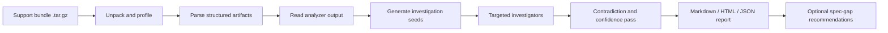

# PRD: Support Bundle Investigator

**Status:** Revised draft for interview prototype  
**Owner:** Candidate project  
**Document type:** Product Requirements Document  
**Version:** 0.2

## 1. Executive summary

Support Bundle Investigator is a **CLI-first, local-first analysis tool** that takes a Troubleshoot support bundle as input and produces a **ranked, evidence-backed diagnosis report**.

The core product idea is simple:

- **Troubleshoot remains the collection and deterministic analysis layer.**
- **This project adds a deeper investigation layer on top of the generated bundle.**
- **The output is optimized for trust:** likely causes, supporting evidence, contradictions checked, next actions, and explicit missing-data notes.

This should **not** be built as a fork of Troubleshoot. The highest-value work is not changing bundle generation; it is turning an already-generated bundle into a faster, more credible triage workflow.

The prototype will be judged most favorably if it demonstrates:

1. strong domain judgment,
2. evidence traceability,
3. realistic scope control,
4. a useful end-to-end workflow,
5. technical depth beyond simple summarization.

## 2. Product thesis

A support bundle is already a curated evidence package. The best AI product here is not a generic chat interface over a tarball and not a replacement for Troubleshoot analyzers.

The right product is a **bundle triage engine** that:

- starts from deterministic analyzer results,
- inspects structured bundle artifacts and logs,
- correlates findings across sources,
- ranks likely causes,
- states uncertainty honestly,
- recommends next actions,
- and highlights what the support bundle spec failed to collect.

That positioning is both technically credible and differentiated.

## 3. Why this project exists

Support bundle analysis is still highly manual.

Even when a bundle contains the right data, a support engineer often has to inspect:

- analyzer output,
- pod and workload state,
- events,
- container logs,
- Helm or release metadata,
- cluster resource manifests,
- storage or networking symptoms.

This is hard because the evidence is spread across multiple formats, deterministic analyzers only capture known patterns, and the engineer needs a defensible answer rather than a plausible summary.

## 4. Opportunity

A useful prototype can compress the first phase of support triage into one step:

> Input a support bundle, output a credible investigation report.

The report should answer:

1. What is most likely broken?
2. Why does the system think that?
3. What evidence supports it?
4. What contradictions were checked?
5. What should the operator do next?
6. What evidence is missing?
7. What should be added to the support bundle spec next time?

## 5. Positioning relative to existing Replicated/Troubleshoot capabilities

This project is intentionally **adjacent to**, not **in conflict with**, the existing ecosystem.

### What already exists

Troubleshoot and related Replicated flows already provide:

- support bundle generation,
- deterministic analyzers,
- collector and redaction specs,
- local bundle generation and review workflows,
- optional sharing workflows in some environments.

### What this prototype adds

This prototype adds value in places where existing deterministic analysis is weakest:

- cross-file correlation,
- ranking and prioritization,
- reasoning over logs plus resources plus analyzer output,
- explicit contradiction checks,
- missing-evidence detection,
- support bundle spec improvement suggestions,
- polished investigation output that feels like senior support triage.

### What this prototype does not try to replace

- support bundle creation,
- built-in deterministic analyzer execution,
- core Troubleshoot collection semantics,
- production cloud support workflows.

## 6. Recommendation on repo strategy

### Recommended approach

Build this as a **separate repository** that consumes support bundles.

### Do not fork Troubleshoot for the MVP

Forking Troubleshoot would create unnecessary scope and muddy the interview signal.

A fork would suggest that the primary novelty is in bundle generation or analyzer engine changes. That is not the strongest use of five days. It also makes it harder for reviewers to isolate what was actually built for the assignment.

### Use Troubleshoot as upstream infrastructure

The project should treat Troubleshoot as:

- the bundle format and evidence source,
- the provider of analyzers and collector semantics,
- the mechanism for generating realistic test bundles,
- a domain reference for what data is expected to exist.

### Stretch integration path

If time remains, add a tiny integration surface such as:

- importing analyzer JSON directly,
- accepting bundle metadata in Troubleshoot-like structure,
- outputting recommended collector/analyzer additions.

## 7. Users

### User 1: Customer operator
Wants local, safe, understandable analysis without data egress.

### User 2: Vendor support engineer
Wants ranked hypotheses, the fastest path to likely root cause, and exact evidence references.

### User 3: SRE or developer
Wants raw paths, stronger technical detail, and enough evidence to validate or reject the diagnosis.

### User 4: Product/platform team
Wants to learn which recurring incidents should be turned into better collectors, analyzers, or docs.

## 8. Goals

### Primary goals

1. Turn a support bundle into a useful triage report within a few minutes.
2. Ensure every surfaced finding has evidence.
3. Improve on plain analyzer output by correlating multiple artifact types.
4. Work offline by default.
5. Produce a demo that clearly shows product judgment, not just coding speed.

### Secondary goals

1. Detect when evidence is insufficient.
2. Suggest missing collector or analyzer coverage.
3. Preserve an investigation trace that can be explained in the demo.
4. Be straightforward to run from a clean repo.

## 9. Non-goals

1. Replacing Troubleshoot.
2. Building a production SaaS.
3. Autonomous remediation.
4. Solving every possible failure mode.
5. Depending on cloud inference for core functionality.
6. Shipping a complex web app in the first version.

## 10. Product principles

### 10.1 Deterministic-first
Native analyzer results and structured bundle facts should anchor the investigation.

### 10.2 Evidence before explanation
Good prose without evidence is failure.

### 10.3 Local-first and privacy-aware
The best default is fully local analysis with no required egress.

### 10.4 Honest uncertainty
The tool must say when it does not know.

### 10.5 Narrow and deep beats broad and shallow
It is better to solve a few realistic failure modes convincingly than many modes superficially.

### 10.6 Product judgment matters more than agent novelty
The best differentiator is not “uses agents.” It is “produces a support-worthy answer.”

## 11. Core product experience

### Input

A Troubleshoot support bundle `.tar.gz`.

### Output

A report containing:

- executive summary,
- ranked findings,
- likely root cause,
- supporting evidence references,
- contradictions checked,
- next steps,
- missing-evidence notes,
- optional support bundle spec recommendations.

### Experience standard

The output should feel like a strong support engineer performed first-pass triage.

## 12. Product differentiation

To stand out in a pool where many candidates use AI coding tools, the prototype must show more than “LLM over files.”

The strongest differentiators are:

### 12.1 Evidence-backed findings
Each finding should include exact file paths and concise notes about what was observed.

### 12.2 Contradiction checking
The system should actively look for evidence that weakens its own hypothesis.

### 12.3 Missing-evidence handling
The system should say when the bundle lacks required evidence.

### 12.4 Spec-improvement recommendations
The system should identify where support bundle collection was insufficient and suggest what collector or analyzer should be added next time.

### 12.5 Strong seeded demos
A few realistic, explainable scenarios will matter more than a huge feature surface.

## 13. Functional requirements

### FR-1: Bundle ingestion

The system must:

- accept a support bundle archive,
- unpack it safely,
- build a file manifest,
- detect corrupt or partial bundles,
- identify known artifact classes.

### FR-2: Bundle profiling

The system must generate a profile that summarizes:

- analyzer outputs,
- namespace and workload inventory,
- pod readiness and restart signals,
- events,
- cluster metadata when available,
- release metadata when available,
- artifact counts,
- obvious coverage gaps.

### FR-3: Structured parsing

The system must parse at least these categories when present:

- analyzer outputs,
- Kubernetes resource manifests,
- events,
- pod descriptions or summaries,
- release or Helm metadata,
- selected config values.

### FR-4: Log investigation

The system must:

- identify important log files,
- extract windows around likely errors,
- deduplicate noisy repeats,
- preserve path references,
- support basic timeline reconstruction.

### FR-5: Finding generation

The system must generate findings that include:

- title,
- severity,
- confidence,
- likely affected component,
- evidence list,
- reasoning summary,
- contradictions checked,
- recommended action,
- missing evidence if applicable.

### FR-6: Report generation

The system must produce:

- a Markdown report,
- an HTML report,
- a JSON findings file.

### FR-7: Spec-gap recommendations

When confidence is reduced due to missing bundle data, the system should optionally recommend:

- a missing collector,
- a missing analyzer,
- a missing redaction rule,
- or a change to bundle coverage.

### FR-8: Traceability

The system must preserve a lightweight investigation trace that can be shown during the demo or used for debugging.

## 14. Non-functional requirements

### NFR-1: No required network access
The default mode must run locally.

### NFR-2: Reproducibility
The same bundle should yield broadly stable findings.

### NFR-3: Explainability
Every reported conclusion must be inspectable.

### NFR-4: Extensibility
New heuristics or specialist analyzers should be easy to add.

### NFR-5: Low setup burden
The repo should be simple to clone, install, and run.

## 15. Proposed solution design

## 15.1 High-level flow



## 15.2 Investigation model

This project may use agent orchestration internally, but the product should be described as a **targeted investigation pipeline**.

That framing is stronger because the user value is not “many agents.” The user value is:

- faster triage,
- stronger evidence,
- better prioritization,
- clearer next actions.

### Recommended internal structure

1. **Profiler**: builds the initial bundle summary.
2. **Seed generator**: turns analyzer results and heuristics into investigation leads.
3. **Kubernetes investigator**: checks workload, pod, event, PVC, and readiness issues.
4. **Log investigator**: checks recurring errors, crash loops, dependency failures, auth issues, and timing patterns.
5. **Configuration investigator**: checks suspicious config values and mismatches.
6. **Verifier**: checks evidence sufficiency, contradictions, and confidence.
7. **Reporter**: writes the final outputs.

This can be implemented with agents, a state machine, or structured task runners. The PRD should not require a specific orchestration fashion beyond producing a debuggable trace.

## 15.3 Why not one-shot summarization

A single prompt over the whole bundle is weak because support bundles are:

- too large,
- too heterogeneous,
- too noisy,
- and too dependent on targeted inspection.

The system should inspect selectively rather than summarize indiscriminately.

## 16. Data model

Each finding should follow a common schema.

```json
{
  "title": "Database hostname misconfiguration",
  "severity": "high",
  "confidence": 0.86,
  "affected_components": ["web", "api"],
  "reasoning_summary": "Application logs show repeated DNS lookup failures for the configured DB host and no matching Service is present in cluster resources.",
  "evidence": [
    {
      "path": "logs/app/current.log",
      "note": "lookup db.internal: no such host"
    },
    {
      "path": "cluster-resources/services/default/",
      "note": "No Service matching configured DB endpoint"
    }
  ],
  "contradictions_checked": [
    "No successful DB connection logs found",
    "No healthy Service with matching DNS name found"
  ],
  "recommended_action": "Update the DB host to the correct in-cluster Service name or restore name resolution.",
  "missing_evidence": []
}
```

## 17. MVP scope

## 17.1 Must ship

1. CLI entry point.
2. Bundle ingestion and unpacking.
3. Parsing for analyzer outputs, Kubernetes resources, events, and logs.
4. Evidence-backed findings.
5. Markdown plus HTML plus JSON output.
6. At least 3 realistic demo scenarios.
7. Investigation trace.
8. Clean README and demo video.

## 17.2 Strong stretch items

1. Spec-improvement recommendations.
2. Bundle diffing against a healthy baseline.
3. Optional local vector retrieval.
4. Tiny local web viewer.

## 17.3 Cut first if behind

1. Interactive chat.
2. Upload or cloud workflow simulation.
3. Multi-bundle memory.
4. Fancy UI.

## 18. Recommended seeded failure scenarios

These should be chosen for realism and explainability.

### Scenario 1: Wrong database endpoint
Good for showing config plus log plus resource correlation.

### Scenario 2: CrashLoopBackOff due to missing secret or env var
Good for showing why logs and workload state must be combined.

### Scenario 3: ImagePullBackOff or bad image tag
Good for showing that deterministic Kubernetes symptoms can be summarized quickly.

### Scenario 4: PVC pending or storage class mismatch
Good for showing infrastructure-adjacent triage.

### Scenario 5: DNS or upstream dependency failure
Good for cross-source reasoning and uncertainty handling.

The MVP only needs three scenarios if they are polished.

## 19. Evaluation plan

The prototype should be evaluated on the dimensions that matter for support.

### 19.1 Correctness
Does the real root cause appear in the top findings?

### 19.2 Evidence quality
Does every important claim cite a concrete artifact?

### 19.3 Trustworthiness
Does the system avoid unsupported confidence?

### 19.4 Usefulness
Would a support engineer save time using this report?

### 19.5 Product insight
Does the tool identify what the bundle spec should have collected but did not?

## 20. Success criteria for the interview version

The interview prototype is successful if:

1. the demo feels like a believable support workflow,
2. the top finding is correct in most seeded scenarios,
3. the report is inspectable and not hand-wavy,
4. the repo is easy to run,
5. the candidate can explain design tradeoffs clearly,
6. the project shows domain knowledge rather than just generic AI tooling.

## 21. Risks and mitigations

### Risk 1: The output feels like a generic LLM summary
**Mitigation:** structure the report around evidence, contradiction checks, and explicit artifacts.

### Risk 2: The project duplicates existing Replicated functionality
**Mitigation:** position it clearly as post-bundle triage and spec-gap analysis.

### Risk 3: Too much focus on agent orchestration as a buzzword
**Mitigation:** describe orchestration as implementation detail; emphasize investigation quality.

### Risk 4: Scope explosion
**Mitigation:** keep the surface area CLI-first and scenario-driven.

### Risk 5: Domain-specific blind spots
**Mitigation:** encode realistic failure scenarios and keep unsupported findings low confidence.

## 22. Five-day build plan

### Day 1: Scenarios and ingestion

- create 3 realistic broken scenarios,
- generate support bundles,
- implement unpacking and profiling,
- produce a file manifest and profile summary.

### Day 2: Structured parsing

- parse analyzer output,
- parse Kubernetes resources and events,
- add typed helpers for workload and pod health,
- classify important logs.

### Day 3: Investigation pipeline

- implement seed generation,
- implement targeted investigators,
- define finding schema,
- add contradiction checks and confidence rules.

### Day 4: Reporting and differentiation

- generate Markdown, HTML, and JSON reports,
- add missing-evidence handling,
- add first-pass spec recommendation logic,
- polish outputs.

### Day 5: Demo and packaging

- test seeded scenarios,
- tighten the report wording,
- clean the repo,
- record the demo,
- write the approach document.

## 23. Demo strategy

The best demo is short and opinionated.

### Suggested flow

1. Show the bundle input.
2. Run one CLI command.
3. Open the report.
4. Show the top finding.
5. Show the exact evidence paths.
6. Show one contradiction check.
7. Show one missing-evidence or spec recommendation.
8. Briefly explain the implementation pipeline.

### What to avoid in the demo

- long explanation of infrastructure,
- a giant prompt dump,
- vague “AI agent swarm” language,
- too many scenarios,
- UI polish without trust features.

## 24. Implementation strategy with AI coding agents

This section is about **how development is accelerated**, not the user-facing product itself.

AI coding agents can be used effectively during development for:

- parser scaffolding,
- test generation,
- scenario setup scripts,
- report templating,
- schema definition,
- evaluation harnesses,
- docs and packaging.

The important distinction is:

- **development may be agent-assisted**,
- but **the shipped product should justify its design independently of that fact**.

During discussion, the strongest stance is:

> I used AI heavily to move quickly, but the product choices were driven by the support workflow, trust requirements, and Troubleshoot domain constraints.

## 25. Why this should be impressive

This PRD is strong enough to support an impressive prototype because it gives you room to demonstrate:

- understanding of the existing ecosystem,
- respect for local-first and privacy-sensitive workflows,
- strong trust and UX judgment,
- practical scope control,
- technical implementation depth,
- and one genuinely differentiated feature: spec-gap recommendations.

It is ambitious enough to stand out, but constrained enough to finish.

## 26. Final recommendation

Build a **separate repo** that analyzes support bundles after they are generated.

Aim for a prototype that is:

- CLI-first,
- local-first,
- evidence-backed,
- deterministic-first,
- narrow in scope,
- and strong on missing-evidence plus spec-improvement recommendations.

That is the clearest path to a demo that feels thoughtful, domain-aware, and difficult to dismiss as generic AI tooling.
